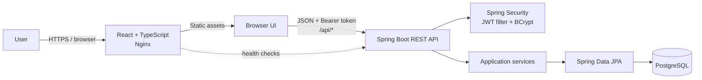
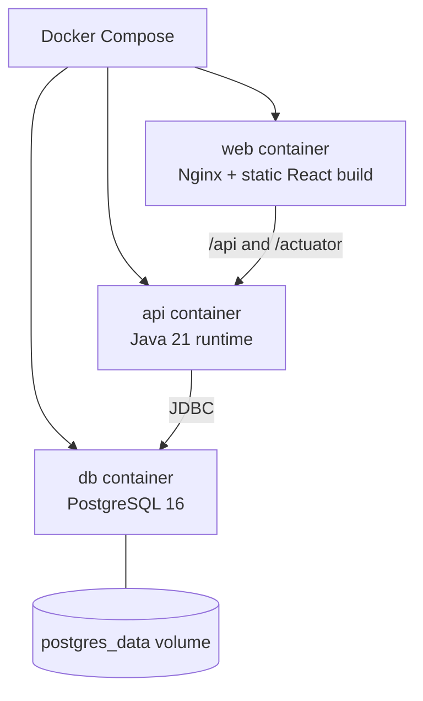

# Architecture

CareerTrack keeps the browser, API, and database in separate parts of the repository and deployment. The browser talks to the API over JSON; the API owns authentication, validation, and data access.

## Request flow

1. Registration accepts a name, email, and password. The API normalizes the email, hashes the password with BCrypt, and returns a signed access token.
2. The frontend sends that token in the `Authorization` header for account-scoped routes.
3. The security filter validates the token and resolves its user ID before the controller handles a request.
4. The application service uses repository methods that include the user ID, so one account cannot read or modify another account’s records.
5. Controllers return DTOs rather than JPA entities. This keeps persistence details out of the API response.

## Local deployment

Nginx serves the compiled frontend and forwards API requests to the Java service. Compose waits for PostgreSQL and the API health checks before starting dependent services. In a hosted environment, PostgreSQL can be replaced with a managed database while keeping the same service boundaries.

## Package map

- `application`: application entity, status, request/response DTOs, repository, service, controller.
- `auth`: register/login requests and account endpoints.
- `security`: token creation/validation, request filter, stateless security rules.
- `user`: account entity and persistence interface.
- `common`: API exception shape and validation/error mapping.
